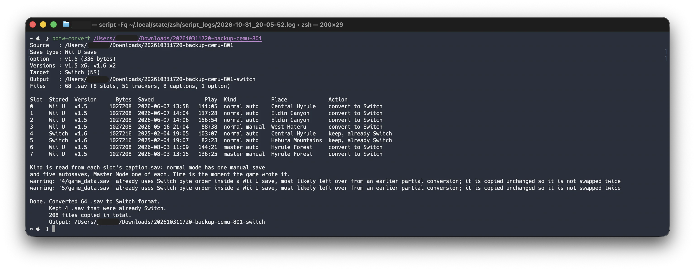
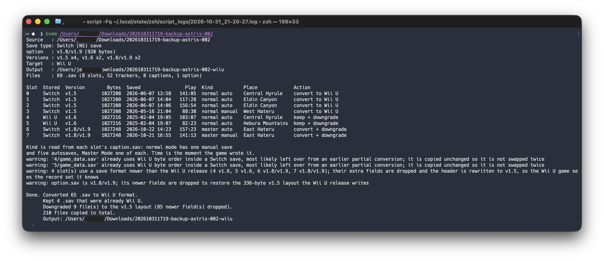

# BotW Save Manager for Mac

**《塞尔达传说：旷野之息》Wii U ↔ Switch 存档互转工具，macOS 原生命令行程序。**

单文件、零第三方依赖、不需要安装 .NET。基于 [DeltaJordan/BotW-Save-Manager](https://github.com/DeltaJordan/BotW-Save-Manager) 的转换逻辑用 Rust 重写，并补上了原项目不支持的**跨版本降级**（1.6 / 1.8 / 1.9 存档转回 Wii U）。

> 本项目是第三方工具，与 Nintendo 无关。存档格式的研究来自社区。

**中文** | [English](#botw-save-manager-for-mac-english)

---

## 截图

Wii U（Cemu）→ Switch：



Switch → Wii U（含 1.9.0 存档的降级）：



截图是真实存档的运行输出，涉及用户目录的部分已打码。

## 这是什么

旷野之息的存档在两个平台上字节序相反：Switch 是小端，Wii U 是大端。把存档从一台机器搬到另一台，需要按规则翻转数值字段，而不是简单地把整个文件倒过来——文件里有字符串、有特殊结构的 tracker 文件，翻错就直接损坏。

这个工具做三件事：

1. 读 `option.sav` 判断整份存档属于哪个平台，自动决定转换方向；
2. 逐个 `.sav` 文件检查头部，翻转需要翻转的数值字段（已经是目标字节序的文件原样复制，不会二次翻转）；
3. 目标是 Wii U 且源存档版本比 Wii U 新时，把 Wii U 不认识的字段丢掉、版本号改回 v1.5，使它变成 Wii U 能读的存档。

## 主要功能

- **双向转换**：Wii U → Switch、Switch → Wii U，同一个命令，自动识别方向
- **跨版本**：v1.6 / v1.8-v1.9 存档可降级为 Wii U 能读的 v1.5 记录集（上游项目要求两端版本一致，这一步它没有）
- **逐槽位报告**：转换前打印 8 个槽位的平台、版本、字节数、保存时间、游玩时长、地区，以及该槽是**手动存档还是自动存档**（读自 `caption.sav`）
- **默认输出到源目录旁边**：不给输出目录时生成 `<原名>-switch` / `<原名>-wiiu`，不会覆盖原存档
- **预检模式**：`--dry-run` 只读不写，可以先看报告再决定
- **输入只读**：绝不修改输入目录，输出目录必须不存在
- **原子写入**：先在临时目录转换，逐个校验后整体改名到目标位置；失败自动清理
- **单文件**：通用二进制约 730 KB（单架构约 362 KB），无运行时依赖，只链接系统 `libSystem`
- **零 crate**：`[dependencies]` 为空，构建不需要下载任何第三方代码

## macOS 支持情况

| 项目 | 状态 |
|---|---|
| 开发与测试环境 | macOS 26.5.2，Apple Silicon（arm64），rustc 1.99 |
| 架构 | Release 分别提供 arm64、x86_64 和两者通用的三个包。arm64 已实测；x86_64 编译通过、`lipo` 合成后能运行，但未在 Intel 真机上验证 |
| 依赖 | 仅 Rust 标准库 + 系统 `libSystem`。无需 .NET、Python、Homebrew 运行时 |
| 产物 | 三个包：arm64 191 KB、x86_64 201 KB、通用 378 KB（解压后 362 / 363 / 730 KB） |
| 签名 | 不做代码签名，也没有公证。从 Release 下载的二进制首次运行要去掉 quarantine，命令见上文「下载预编译版本」 |

macOS 的 `~/Downloads`、`~/Desktop` 会在首次访问时弹出隐私授权。授权被拒时系统会允许写入但拒绝 `rename`，工具会自动回退为“复制已完成的临时目录到目标位置”，结果一致。

## 环境要求

**运行**：macOS，Apple Silicon 或 Intel（arm64 已实测，x86_64 未在真机验证）。不需要安装 Rust。

**构建**：Rust 1.85 或更高（使用 edition 2024）。

**存档**：已经解密、导出的存档文件夹，目录里必须直接包含 `option.sav`。工具不读取主机内部存储，也不处理加密容器。

模拟器存档的常见位置（随版本可能不同）：

```text
Cemu    ~/Library/Application Support/Cemu/mlc01/usr/save/00050000/101c9300/user/80000001/
Ryujinx ~/Library/Application Support/Ryujinx/bis/user/save/0000000000000002/0/
```

## 构建与安装

### 下载预编译版本（不用装 Rust）

到 [Releases](https://github.com/Jeasin/BotW-Save-Manager-for-Mac/releases/latest) 按机器挑一个包：

| 你的 Mac | 下载 | 包体积 |
|---|---|---|
| Apple Silicon（M1 及以后） | `bsmm-1.0.0-macos-arm64.tar.gz` | 191 KB |
| Intel | `bsmm-1.0.0-macos-x86_64.tar.gz` | 201 KB |
| 不确定，或者想一个文件到处跑 | `bsmm-1.0.0-macos-universal.tar.gz` | 378 KB |

分不清就跑 `uname -m`：输出 `arm64` 是 Apple Silicon，`x86_64` 是 Intel。三个包里的程序功能完全一样，只是编译目标不同；单架构包只有通用包的一半大，所以按机器挑更省事。

每个包都有同名 `.sha256`。校验并安装（把 `A` 换成你下的那个标签）：

```bash
V=1.0.0
A=arm64    # arm64 / x86_64 / universal
shasum -a 256 -c bsmm-$V-macos-$A.tar.gz.sha256    # 输出 OK 才继续
tar -xzf bsmm-$V-macos-$A.tar.gz
install -m 755 bsmm ~/.local/bin/bsmm
```

从浏览器下载的文件带 quarantine 标记，首次运行会被 Gatekeeper 拦下，去掉它：

```bash
xattr -d com.apple.quarantine ~/.local/bin/bsmm
```

用 `curl`、`git clone` 或自己编译的二进制没有这个标记，跳过即可。

### 从源码编译

```bash
git clone git@github.com:Jeasin/BotW-Save-Manager-for-Mac.git
cd BotW-Save-Manager-for-Mac
cargo build --release
```

产物在 `target/release/bsmm`。安装到用户目录：

```bash
mkdir -p ~/.local/bin
install -m 755 target/release/bsmm ~/.local/bin/bsmm
```

如果 `~/.local/bin` 不在 `PATH` 里：

```bash
echo 'export PATH="$HOME/.local/bin:$PATH"' >> ~/.zshrc
```

也可以装到系统路径（需要管理员权限）：

```bash
sudo install -m 755 target/release/bsmm /usr/local/bin/bsmm
```

## 使用

```bash
bsmm [选项] <输入目录> [输出目录]
```

不写输出目录时，工具在输入目录的**同级**创建带平台后缀的新目录：

```text
.../80000001/BotW/          →  .../80000001/BotW-switch
.../0/save-backup/          →  .../0/save-backup-wiiu
```

输入名本身已带 `-switch` / `-wiiu` 时会替换后缀，不会叠加。

### 命令示例

先预检，只读不写：

```bash
bsmm --dry-run ~/Downloads/zelda-save
```

确认无误后转换，产物落在 `~/Downloads/zelda-save-wiiu`（或 `-switch`）：

```bash
bsmm ~/Downloads/zelda-save
```

指定输出目录（必须尚不存在，缺失的父目录会自动创建）：

```bash
bsmm ~/Downloads/zelda-save ~/Downloads/out/zelda-switch
```

手上已经有一份 Wii U 的 `option.sav`，想直接用它而不是自动降级：

```bash
bsmm --option-sav ~/Downloads/wiiu-option.sav ~/Downloads/zelda-save
```

查看每个 `.sav` 文件的处理方式：

```bash
bsmm --verbose ~/Downloads/zelda-save
```

### 选项

```text
-n, --dry-run              只检查，不写入任何文件
    --allow-unsupported    允许未知游戏版本继续转换（按已知字段表降级并告警）
    --drop-incompatible    Switch → Wii U 时，跳过没有字段表、无法降级的槽位
    --option-sav <FILE>    Switch → Wii U 时，用指定的 Wii U option.sav 覆盖输出
-v, --verbose              列出每个 .sav 的处理方式
-h, --help                 显示帮助
-V, --version              显示版本
```

退出码：`0` 成功，`1` 失败，`2` 参数错误，`3` 存档不受支持（版本号无法识别且未加 `--allow-unsupported`）。

### 一次真实运行

```text
$ bsmm --dry-run ~/Downloads/zelda-save

Source   : /Users/me/Downloads/zelda-save
Save type: Switch (NS) save
option   : v1.8/v1.9 (920 bytes)
Versions : v1.5 x4, v1.6 x2, v1.8/v1.9 x2
Target   : Wii U
Output   : /Users/me/Downloads/zelda-save-wiiu
Files    : 69 .sav (8 slots, 52 trackers, 8 captions, 1 option)

Slot  Stored  Version        Bytes  Saved                Play  Kind           Place             Action
0     Switch  v1.5         1027208  2026-06-07 13:58   141:05  normal auto    Central Hyrule    convert to Wii U
1     Switch  v1.5         1027208  2026-06-07 14:04   117:28  normal auto    Eldin Canyon      convert to Wii U
2     Switch  v1.5         1027208  2026-06-07 14:06   156:54  normal auto    Eldin Canyon      convert to Wii U
3     Switch  v1.5         1027208  2026-05-16 21:04    88:38  normal manual  West Hateru       convert to Wii U
4     Wii U   v1.6         1027216  2025-02-04 19:05   103:07  normal auto    Central Hyrule    keep + downgrade
5     Wii U   v1.6         1027216  2025-02-04 19:07    82:23  normal auto    Hebura Mountains  keep + downgrade
6     Switch  v1.8/v1.9    1027248  2026-10-22 14:23   157:23  master auto    East Hateru       convert + downgrade
7     Switch  v1.8/v1.9    1027248  2026-10-21 16:55   141:13  master manual  East Hateru       convert + downgrade
```

各列含义：

| 列 | 含义 |
|---|---|
| `Files` | 目录里 `.sav` 总数，以及按用途的分类（槽位、tracker、caption、option、重复副本） |
| `Slot` | 槽位目录名，即 `game_data.sav` 所在的文件夹 |
| `Stored` | 该文件**自身头部**显示的平台，可能和整份存档不一致（见“混排”） |
| `Version` | 从文件头读出的游戏版本 |
| `Saved` | 该档写入的时刻，读自该槽的 `caption.sav` |
| `Play` | 该档累计游玩时长（`小时:分钟`） |
| `Kind` | `normal` / `master` 加 `manual` / `auto` |
| `Place` | 存档时的地区名 |
| `Action` | `convert` 翻转字节序、`keep` 原样复制、`drop` 不写入输出；`+ downgrade` 表示同时降级 |

### 槽位、自动保存与手动保存

一份存档固定有 8 个槽位目录 `0`–`7`，它们不是 8 个平级的自由存档位：

- **普通模式 6 个**：1 个手动存档 + 5 个轮换的自动存档
- **大师模式 2 个**：1 个手动 + 1 个自动

目录名由游戏固定分配。**“这一档是手动还是自动”不写在 `game_data.sav` 里**，而是写在每个槽位旁边的 `caption.sav`——也就是读档界面显示的那些信息：

| 字段哈希 | 含义 |
|---|---|
| `0x0ba7cf40` | 写入时刻（Unix 时间戳） |
| `0xa0678286` | 该档游玩时长（分钟） |
| `0xe51256e2` | `1` = 大师模式 |
| `0x4acb5004` | `0` = 手动存档，`1` = 自动存档 |
| `0x46d266b6` | 地点名（每 4 字节一条记录，哈希重复） |
| `0xf26f1a02` | `MapArea_*` 地区 id |

这几个哈希是在真实存档上对出来的：时间与时长和读档界面一致，两个标志位把 8 个槽切成「普通 6 / 大师 2」，且每个模式正好一个手动档，与官方存档结构吻合。`caption.sav` 缺失或损坏时，这几列显示 `-`，不影响转换。

`Saved` 是**游戏自己时钟的读数**（按 UTC 渲染）。模拟器把这个时钟设成本机时间，所以在模拟器存档上看到的就是保存时的钟点；真机存档可能相差一个时区。

## 版本与降级

| 版本 | 头部 | Wii U | Switch | 说明 |
|---|---|---|---|---|
| v1.5 | `0x471b` | ✅ 最终版本 | ✅ | 双向转换最稳妥 |
| v1.6 | `0x471e` | ⚠️ 无此更新 | ✅ | 仅 Switch 有（Labo VR），转 Wii U 时丢 1 个字段 |
| v1.8 / v1.9 | `0x4730` | ⚠️ 无此更新 | ✅ | 转 Wii U 时丢 5 个字段（`game_data.sav`） |

Wii U 版最后一次更新是 2018-01 的 1.5.0，任天堂官方也写明 Wii U 没有 1.6.0 及之后的更新。1.6.0 与 1.8/1.9 都只面向 Switch 系；`0x4730` 同时覆盖 1.8.x 与 1.9.x，存档本身无法区分这两者，所以标签合并为 `v1.8/v1.9`。

### 降级是怎么做的

`option.sav`、`game_data.sav`、`caption.sav` 用的是**同一个容器**：

```text
0x00  u32  版本号
0x04  u32  不变
0x08  u32  不变
0x0c  ...  { u32 字段哈希; u32 值 } 重复
末尾  u32  0xffffffff 终止符
```

它是**按哈希索引的键值表**，不是固定偏移，所以“新版本”只是在同一张表里多了若干条记录。降级因此很直接：

1. 丢掉 Wii U 版不认识的字段（`game_data.sav` 5 个、`option.sav` 10 个哈希）；
2. 把头部版本号改成 `0x471b`；
3. 其余记录原封不动保留（进度、物品、地图数据都在这些记录里）。

以实测的 1.9.0 存档为例：

| 文件 | 原始 | 降级后 | 丢掉 |
|---|---|---|---|
| `game_data.sav` | 1027248 B / 128404 条 | 1027208 B / 128399 条 | 5 条（40 B） |
| `option.sav` | 920 B / 113 条 | 336 B / 40 条 | 73 条（10 个哈希，含数组/字符串块） |
| `caption.sav` | 1528 B | 1528 B | 无，只改版本号 |

被丢掉的字段是游戏设置类的新条目，不是进度数据；代价是这些新设置项在 Wii U 上不存在，回到 Switch 时也不会被还原。

### 为什么有些槽位是“混排”的

判据只有一条：**平台字节序是游戏自己写死的**。Switch 版永远写小端（头部 `xx 47 00 00`），Wii U 版永远写大端（头部 `00 00 47 xx`）。一个 Switch 存档里出现大端文件（或反过来），只可能是转换器或手工拷贝放进去的。

实测的两份存档就是这种情况：

| 槽位 | Ryujinx（Switch 存档） | Cemu（Wii U 存档） | 结论 |
|---|---|---|---|
| 0–3 | `1b 47 00 00` 小端 v1.5 | `00 00 47 1b` 大端 v1.5 | 正常 |
| 4–5 | `00 00 47 1e` **大端** v1.6 | `1e 47 00 00` **小端** v1.6 | 两边都放了对方的格式 |
| 6–7 | `30 47 00 00` 小端 v1.8/v1.9 | `00 00 47 1b` 大端 v1.5 | 正常 |

因此处理方式是：**已经是目标平台字节序的文件只复制、不翻转**，需要时再降级；否则二次翻转会直接把存档写坏。这种情况会以 warning 列出。

## 注意事项与已知限制

- **先备份**。工具是只读输入、原子输出，但存档是你自己的，出问题没人能替你恢复。
- **没有在真机上验证过导入**。两个方向都用真实存档在字节层面验证过：Wii U → Switch 的产物中，0–3 号槽与 Ryujinx 正在使用的文件逐字节相同；Switch → Wii U 的产物 8 个槽位与 Cemu 原生存档的记录序列逐条一致，并已在 Cemu 中载入。但未在实机 Wii U / Switch 上完成导入测试。
- **降级不可逆**：被丢掉的新设置字段无法在转回 Switch 后自动还原。不要删除原始 Switch 存档。
- 只处理**已解密、已导出**、包含 `option.sav` 的存档文件夹；不读取主机内部存储或加密容器。
- 版本表覆盖 v1.0 – v1.6、v1.8/v1.9。**任意大于 `0x471b` 的头**默认被拒绝：加 `--allow-unsupported` 会按已知字段表降级并告警，加 `--drop-incompatible` 则把这些槽位排除在输出之外。
- 被社区编辑器改造过的存档（头部形如 `0x0f423d` 的 `v1.6*`）超出 `0x47xx` 形状，会被当成无法识别。
- **转换不改 DLC 归属，也不改语言设置**：目标平台没有的 DLC 内容可能被游戏自己清掉。
- 云同步（iCloud、OneDrive）产生的重复副本（如 `game_data-NSConflict-5.sav`）会被识别并提示，仍按普通 `.sav` 处理。
- 转换结果只是数据文件，不包含任何破解、解密或绕过校验的功能。

## 开发与测试

```bash
cargo fmt --check
cargo clippy --all-targets -- -D warnings
cargo test
cargo build --release
```

当前 27 个单元测试 + 24 个集成测试，覆盖：转换常量、平台/版本识别、哈希与物品分支、trackblock 特殊处理、记录表解析与降级、逐槽位动作判定、完整目录转换、`--option-sav` 覆盖、输出保护、`caption.sav` 解析与 CLI 退出码。

## 发布 Release（维护者）

发一个新版本就四步，前三步在本机完成。

**1. 定版本号**：改 `Cargo.toml` 的 `version`，它决定 `bsmm --version` 的输出；tag 用同一个号，前面加 `v`。

**2. 构建并打包**：两个架构各编译一次，再合成一个通用版，一共三个包。

```bash
rustup target add aarch64-apple-darwin x86_64-apple-darwin   # 只需一次
cargo build --release --target aarch64-apple-darwin
cargo build --release --target x86_64-apple-darwin
lipo -create -output bsmm-universal \
  target/aarch64-apple-darwin/release/bsmm \
  target/x86_64-apple-darwin/release/bsmm

V=1.0.0
pack() {   # $1 = 架构标签（写进文件名）, $2 = 要装的二进制
  rm -rf stage && mkdir stage
  cp "$2" stage/bsmm && cp LICENSE.md NOTICE stage/
  tar -czf bsmm-$V-macos-$1.tar.gz -C stage bsmm LICENSE.md NOTICE
  shasum -a 256 bsmm-$V-macos-$1.tar.gz > bsmm-$V-macos-$1.tar.gz.sha256
  rm -rf stage
}
pack arm64     target/aarch64-apple-darwin/release/bsmm
pack x86_64    target/x86_64-apple-darwin/release/bsmm
pack universal bsmm-universal
```

三个包分别是 Apple Silicon、Intel 和两者通吃。单架构包只有通用包的一半大，所以三个都要发，不能只发通用包——否则 Apple Silicon 用户白下一倍的体积。

**3. 提交、打 tag、推送**

```bash
git commit -am "Release v1.0.0"
git tag -a v1.0.0 -m "bsmm v1.0.0"
git push origin main
git push origin v1.0.0
```

**4. 发布**：装了 [GitHub CLI](https://cli.github.com/) 的话一条命令搞定，附件会自动上传：

```bash
gh release create v1.0.0 bsmm-1.0.0-macos-*.tar.gz* \
  --title "bsmm v1.0.0" --generate-notes
```

通配符会展开成 6 个文件（3 个包 + 3 个校验值）。注意别在还留着旧版本包的目录里跑，否则会把旧包一起传上去。

`--generate-notes` 会让 GitHub 按两次 tag 之间的提交自动生成说明；想自己写就换成 `--notes-file 说明.md`。

不装 `gh` 就在网页上做：仓库首页右侧 **Releases** → **Draft a new release** → *Choose a tag* 里选第 3 步推上去的 `v1.0.0` → 填标题与说明 → 把 3 个 `.tar.gz` 和 3 个 `.sha256` 一起拖进附件区 → **Publish release**。tag 没先推上去，下拉框里就选不到。

两个容易踩的地方：

- tag 名去掉 `v` 前缀后要和 `Cargo.toml` 的 `version` 一致，否则下载页的版本号和 `bsmm --version` 对不上；
- 附件用 `.tar.gz` 而不是 `.zip`：`tar` 保留可执行权限，解压后直接 `install` 就能用；zip 解出来没有执行位，还要补 `chmod +x`。

## 与上游项目的差异

本项目**不是**上游代码的编译产物，而是用 Rust 重写的命令行实现。哪些来自上游、哪些是这里新增的：

| | 上游 BotW Save Manager | 本项目 |
|---|---|---|
| 运行环境 | .NET 6，Windows / Linux 桌面程序与控制台 | 原生单文件，macOS |
| 版本要求 | 两端必须同版本（README 原文：“upgrade/downgrade untested”） | 支持降级到 v1.5 |
| 转换内核 | `BotwSaveManager.Core/BotwSave.cs` 的 `ConvertPlatform` | 移植同一算法与常量表 |
| 记录表解析 | 无 | 新增：解析 / 裁剪 / 改写容器 |
| 读档信息 | 无 | 新增：从 `caption.sav` 读时间、时长、地区、手动/自动 |
| 写入策略 | 直接写目标目录 | 临时目录 + 校验 + 原子改名 |
| 逐文件字节序检测 | 按整份存档判断 | 每个 `.sav` 单独判断 |

上游的 `LICENSE.md` 与本项目的 `LICENSE.md` **逐字节相同**，没有改动。

## Credits / 致谢

- **[DeltaJordan](https://github.com/DeltaJordan)（Jordan Marine）** —— [BotW-Save-Manager](https://github.com/DeltaJordan/BotW-Save-Manager) 的作者。本项目的字节翻转算法、44 个免翻转哈希、60 个物品字符串、版本头表都移植自该项目的 `BotwSaveManager.Core/BotwSave.cs`。上游 README 还提到 Arch Leaders 等贡献者。
- **WemI0** —— 上游项目 fork 自 [`BOTW_SaveConv`](https://github.com/WemI0/BOTW_SaveConv)，更早的格式研究来自这里。
- **[fabiangonzalezdev/Universal-BOTW-Save-Manager](https://github.com/fabiangonzalezdev/Universal-BOTW-Save-Manager)** —— 其 `docs/FORMAT.md` 用于交叉核对新增字段的哈希。
- **[marcrobledo](https://www.marcrobledo.com/savegame-editors/zelda-botw/)** —— 版本标签 `v1.8/v1.9` 的归并方式参考了其存档编辑器。
- 以及所有公开研究旷野之息存档格式的社区成员。

本项目的改动（Rust 实现、记录表降级、`caption.sav` 解析、CLI 与安全策略）由本仓库维护者完成，按 AGPL-3.0 同样开源。

## 许可证

本项目以 **GNU Affero General Public License v3.0 only** 发布，见 [`LICENSE.md`](LICENSE.md) 与 [`NOTICE`](NOTICE)。

它衍生自同样使用 AGPL-3.0 的 BotW Save Manager，因此：

- 你可以自由使用、修改、分发，但分发时必须保留同样的许可证与版权声明，并提供完整源码；
- 如果你修改后作为网络服务提供给他人使用，AGPL 要求你向他们提供源码；
- 本程序不提供任何担保。

本项目与 Nintendo 无关联。《塞尔达传说：旷野之息》及相关名称是 Nintendo 的商标。

---
---

# BotW Save Manager for Mac (English)

**A native macOS command-line converter for *The Legend of Zelda: Breath of the Wild* save files, between Wii U and Switch.**

One binary, no third-party dependencies, no .NET runtime. The conversion logic is a Rust rewrite of [DeltaJordan/BotW-Save-Manager](https://github.com/DeltaJordan/BotW-Save-Manager), with one addition the original does not have: **downgrading** a 1.6 / 1.8 / 1.9 save back to the Wii U release.

> Unofficial tool, not affiliated with Nintendo. The save format knowledge comes from the community.

[中文](#botw-save-manager-for-mac) | **English**

## Screenshots

Wii U (Cemu) → Switch:


Switch → Wii U, including a 1.9.0 save that has to be downgraded:


That output comes from real saves; the user's home directory is masked.

## What it does

A Breath of the Wild save stores numbers in the platform's own byte order: little-endian on Switch, big-endian on Wii U. Moving a save between the two means swapping the numeric fields according to a rule — not reversing the whole file. Saves also contain strings and specially structured tracker files, so a blind reversal corrupts them.

The tool does three things:

1. Reads `option.sav` to tell which platform the folder belongs to and picks the conversion direction.
2. Checks every `.sav` file's own header, swaps the numeric words that need swapping, and copies files that already use the target byte order instead of swapping them twice.
3. When the target is Wii U and the save is newer than the last Wii U release, drops the fields the Wii U build does not know and retags the header to v1.5.

## Features

- **Both directions**: Wii U → Switch and Switch → Wii U from one command, direction detected automatically
- **Cross-version**: v1.6 and v1.8-v1.9 saves are downgraded to the v1.5 record set the Wii U release expects (upstream requires both sides to be on the same version)
- **Per-slot report**: platform, version, size, save time, play time, region, and whether the slot is the **manual save or an autosave** (read from `caption.sav`)
- **Output next to the source** by default: `<name>-switch` / `<name>-wiiu`, never touching the original
- **Dry run**: `--dry-run` reads only
- **Input is read-only**: the output folder must not exist
- **Atomic write**: converted into a temporary folder, validated, then renamed into place; failures are cleaned up
- **Single binary**: ~730 KB universal (~362 KB per architecture), no runtime, links only the system `libSystem`
- **Zero crates**: `[dependencies]` is empty

## macOS support

| | |
|---|---|
| Developed and tested on | macOS 26.5.2, Apple Silicon (arm64), rustc 1.99 |
| Architectures | releases ship three packages: arm64, x86_64 and a universal one. arm64 is verified; x86_64 compiles and runs, but has not been tested on an Intel Mac |
| Dependencies | Rust standard library and the system `libSystem`. No .NET, Python or Homebrew runtime needed |
| Artifact | three packages: 191 KB arm64, 201 KB x86_64, 378 KB universal (362 / 363 / 730 KB once unpacked) |
| Signing | not code-signed or notarised. A binary from a release needs its quarantine flag removed the first time — see "Download a prebuilt binary" above |

macOS asks for privacy permission the first time a process touches `~/Downloads` or `~/Desktop`. When that permission is denied the system still allows writing but refuses `rename`; the tool falls back to copying the finished temporary folder into place, with the same result.

## Requirements

**To run**: macOS, Apple Silicon or Intel (arm64 verified; x86_64 not tested on real hardware). Rust is not required.

**To build**: Rust 1.85 or newer (edition 2024).

**Save folder**: already decrypted and exported, with `option.sav` directly inside it. The tool does not read console storage or encrypted containers.

Typical emulator paths (they differ between versions):

```text
Cemu    ~/Library/Application Support/Cemu/mlc01/usr/save/00050000/101c9300/user/80000001/
Ryujinx ~/Library/Application Support/Ryujinx/bis/user/save/0000000000000002/0/
```

## Build and install

### Download a prebuilt binary (no Rust needed)

Pick the package that matches your Mac on [Releases](https://github.com/Jeasin/BotW-Save-Manager-for-Mac/releases/latest):

| Your Mac | Download | Package size |
|---|---|---|
| Apple Silicon (M1 and later) | `bsmm-1.0.0-macos-arm64.tar.gz` | 191 KB |
| Intel | `bsmm-1.0.0-macos-x86_64.tar.gz` | 201 KB |
| Not sure, or want one file for both | `bsmm-1.0.0-macos-universal.tar.gz` | 378 KB |

`uname -m` tells you which: `arm64` is Apple Silicon, `x86_64` is Intel. All three contain the same program, only the compilation target differs — a single-architecture package is half the size of the universal one, so picking your machine saves bandwidth.

Each package has a matching `.sha256`. Verify, unpack and install (set `A` to the tag you downloaded):

```bash
V=1.0.0
A=arm64    # arm64 / x86_64 / universal
shasum -a 256 -c bsmm-$V-macos-$A.tar.gz.sha256    # must print OK
tar -xzf bsmm-$V-macos-$A.tar.gz
install -m 755 bsmm ~/.local/bin/bsmm
```

Files downloaded through a browser carry a quarantine flag and Gatekeeper blocks the first run. Clear it:

```bash
xattr -d com.apple.quarantine ~/.local/bin/bsmm
```

Binaries fetched with `curl`, built from source or cloned with `git` have no such flag — skip that line.

### Build from source

```bash
git clone git@github.com:Jeasin/BotW-Save-Manager-for-Mac.git
cd BotW-Save-Manager-for-Mac
cargo build --release
```

The binary is `target/release/bsmm`. Install it for the current user:

```bash
mkdir -p ~/.local/bin
install -m 755 target/release/bsmm ~/.local/bin/bsmm
```

If `~/.local/bin` is not on your `PATH`:

```bash
echo 'export PATH="$HOME/.local/bin:$PATH"' >> ~/.zshrc
```

Or install system-wide (requires admin rights):

```bash
sudo install -m 755 target/release/bsmm /usr/local/bin/bsmm
```

## Usage

```bash
bsmm [OPTIONS] <INPUT_DIR> [OUTPUT_DIR]
```

Without an output folder, a sibling folder is created with a platform suffix:

```text
.../80000001/BotW/          →  .../80000001/BotW-switch
.../0/save-backup/          →  .../0/save-backup-wiiu
```

If the input name already ends in `-switch` or `-wiiu`, the suffix is replaced rather than appended.

### Examples

Inspect first; nothing is written:

```bash
bsmm --dry-run ~/Downloads/zelda-save
```

Convert, writing to `~/Downloads/zelda-save-wiiu` (or `-switch`):

```bash
bsmm ~/Downloads/zelda-save
```

Pick the output folder explicitly (it must not exist; missing parents are created):

```bash
bsmm ~/Downloads/zelda-save ~/Downloads/out/zelda-switch
```

Supply a Wii U `option.sav` you already have instead of letting the tool downgrade the source one:

```bash
bsmm --option-sav ~/Downloads/wiiu-option.sav ~/Downloads/zelda-save
```

See what happens to every `.sav`:

```bash
bsmm --verbose ~/Downloads/zelda-save
```

### Options

```text
-n, --dry-run              Inspect only, write nothing
    --allow-unsupported    Convert even if the game version is unknown (downgrade
                           with the known field list, and warn about the rest)
    --drop-incompatible    Switch -> Wii U: leave out slots with no field list
    --option-sav <FILE>    Switch -> Wii U: use this Wii U option.sav in the output
-v, --verbose              List every .sav file that is processed
-h, --help                 Print help
-V, --version              Print version
```

Exit codes: `0` success, `1` failure, `2` bad usage, `3` unsupported save (unknown version without `--allow-unsupported`).

### A real run

```text
$ bsmm --dry-run ~/Downloads/zelda-save

Source   : /Users/me/Downloads/zelda-save
Save type: Switch (NS) save
option   : v1.8/v1.9 (920 bytes)
Versions : v1.5 x4, v1.6 x2, v1.8/v1.9 x2
Target   : Wii U
Output   : /Users/me/Downloads/zelda-save-wiiu
Files    : 69 .sav (8 slots, 52 trackers, 8 captions, 1 option)

Slot  Stored  Version        Bytes  Saved                Play  Kind           Place             Action
0     Switch  v1.5         1027208  2026-06-07 13:58   141:05  normal auto    Central Hyrule    convert to Wii U
1     Switch  v1.5         1027208  2026-06-07 14:04   117:28  normal auto    Eldin Canyon      convert to Wii U
2     Switch  v1.5         1027208  2026-06-07 14:06   156:54  normal auto    Eldin Canyon      convert to Wii U
3     Switch  v1.5         1027208  2026-05-16 21:04    88:38  normal manual  West Hateru       convert to Wii U
4     Wii U   v1.6         1027216  2025-02-04 19:05   103:07  normal auto    Central Hyrule    keep + downgrade
5     Wii U   v1.6         1027216  2025-02-04 19:07    82:23  normal auto    Hebura Mountains  keep + downgrade
6     Switch  v1.8/v1.9    1027248  2026-10-22 14:23   157:23  master auto    East Hateru       convert + downgrade
7     Switch  v1.8/v1.9    1027248  2026-10-21 16:55   141:13  master manual  East Hateru       convert + downgrade
```

| Column | Meaning |
|---|---|
| `Files` | number of `.sav` files and what they are: slots, trackers, captions, option, duplicates |
| `Slot` | the slot folder, i.e. where `game_data.sav` lives |
| `Stored` | platform according to the file's **own header**, which may differ from the rest of the save |
| `Version` | game version read from that header |
| `Saved` | when the game wrote that slot, read from its `caption.sav` |
| `Play` | play time of that file, `hours:minutes` |
| `Kind` | `normal` / `master` plus `manual` / `auto` |
| `Place` | region name at save time |
| `Action` | `convert` swaps bytes, `keep` copies as is, `drop` leaves it out; `+ downgrade` means the newer fields are removed too |

### Slots, autosaves and the manual save

A save always has eight slot folders, `0`–`7`, and they are not eight interchangeable save slots:

- **Normal mode, 6 slots**: one manual save plus five rotating autosaves
- **Master Mode, 2 slots**: one of each

The numbering is fixed by the game. Whether a slot is manual or automatic is **not** stored in `game_data.sav`; it lives in the slot's `caption.sav`, the data behind the save-select screen:

| Field hash | Meaning |
|---|---|
| `0x0ba7cf40` | write time (Unix timestamp) |
| `0xa0678286` | play time of that file (minutes) |
| `0xe51256e2` | `1` = Master Mode |
| `0x4acb5004` | `0` = manual save, `1` = autosave |
| `0x46d266b6` | place name (one record per four bytes, hash repeated) |
| `0xf26f1a02` | `MapArea_*` region id |

These hashes were matched against real saves: the time and play time agree with the load screen, and the two flags split the eight slots into "six normal / two Master Mode" with exactly one manual save per mode, matching the documented layout. When a `caption.sav` is missing or unreadable those columns show `-`; conversion is unaffected.

`Saved` is the reading of **the game's own clock**, rendered as UTC. Emulators set that clock to the host time, so on emulator saves it matches when you pressed save; a console save may be off by one time zone.

## Versions and downgrading

| Version | Header | Wii U | Switch | Notes |
|---|---|---|---|---|
| v1.5 | `0x471b` | ✅ final release | ✅ | the safest pair for two-way conversion |
| v1.6 | `0x471e` | ⚠️ never shipped | ✅ | Switch only (Labo VR); one field is dropped when converting to Wii U |
| v1.8 / v1.9 | `0x4730` | ⚠️ never shipped | ✅ | five fields in `game_data.sav` are dropped when converting to Wii U |

The last Wii U update was 1.5.0 in January 2018; Nintendo's own support pages state that Wii U did not receive 1.6.0 or later. `0x4730` covers both 1.8.x and 1.9.x and the file itself cannot tell them apart, so the label stays combined.

### How the downgrade works

`option.sav`, `game_data.sav` and `caption.sav` share **one container**:

```text
0x00  u32  version
0x04  u32  fixed
0x08  u32  fixed
0x0c  ...  { u32 field hash; u32 value } repeated
end   u32  0xffffffff terminator
```

It is a **hash-keyed table**, not a set of fixed offsets, so a newer version is the same table with a few extra records. Downgrading is therefore straightforward:

1. drop the fields the Wii U build does not know (five hashes in `game_data.sav`, ten in `option.sav`);
2. rewrite the header to `0x471b`;
3. keep every other record untouched — progress, items and map data all live there.

Measured on a real 1.9.0 save:

| File | Original | After downgrade | Dropped |
|---|---|---|---|
| `game_data.sav` | 1027248 B / 128404 records | 1027208 B / 128399 records | 5 (40 B) |
| `option.sav` | 920 B / 113 records | 336 B / 40 records | 73 (10 hashes, incl. arrays/strings) |
| `caption.sav` | 1528 B | 1528 B | none, header only |

The dropped entries are new settings, not progress. The cost is that those settings do not exist on Wii U, and they are not restored when you convert back.

### Why some slots are "mixed"

There is one rule: **the byte order is written by the game itself**. The Switch build always writes little-endian (`xx 47 00 00`), the Wii U build always big-endian (`00 00 47 xx`). A big-endian file inside a Switch save can only come from a converter or a manual copy.

That is exactly what the two sample saves show:

| Slots | Ryujinx (Switch save) | Cemu (Wii U save) | Meaning |
|---|---|---|---|
| 0–3 | `1b 47 00 00` little-endian v1.5 | `00 00 47 1b` big-endian v1.5 | normal |
| 4–5 | `00 00 47 1e` **big-endian** v1.6 | `1e 47 00 00` **little-endian** v1.6 | each side holds the other platform's copy |
| 6–7 | `30 47 00 00` little-endian v1.8/v1.9 | `00 00 47 1b` big-endian v1.5 | normal |

So: **a file already in the target byte order is copied, not swapped**, and downgraded if needed. Swapping it again would corrupt it. These files are listed as warnings.

## Caveats and known limitations

- **Back up first.** The tool reads its input and writes atomically, but the save is yours.
- **No console import test yet.** Both directions are verified at byte level on real saves: the Wii U → Switch output's slots 0–3 are byte-identical to the files Ryujinx is running, and the Switch → Wii U output matches a native Cemu save record for record and has been loaded in Cemu. Neither has been imported on real Wii U / Switch hardware.
- **Downgrading is not reversible**: dropped settings cannot be restored when converting back. Keep the original Switch save.
- Only **decrypted, exported** folders containing `option.sav` are handled; console storage and encrypted containers are out of scope.
- The version table covers v1.0 – v1.6 and v1.8/v1.9. **Any header above `0x471b`** is refused by default: `--allow-unsupported` downgrades with the known field list and warns, `--drop-incompatible` leaves those slots out.
- Saves modified by community editors (headers like `0x0f423d`, shown as `v1.6*`) do not have the `0x47xx` shape and are treated as unrecognised.
- **DLC ownership and language settings are not converted**; DLC content the target platform does not own may be removed by the game itself.
- Duplicates created by cloud sync (`game_data-NSConflict-5.sav`) are detected and reported, and still treated as ordinary `.sav` files.
- This is a data converter. It contains nothing that decrypts, dumps or bypasses console protections.

## Development

```bash
cargo fmt --check
cargo clippy --all-targets -- -D warnings
cargo test
cargo build --release
```

27 unit tests and 24 integration tests cover the conversion constants, platform/version detection, the hash and item branches, trackblock handling, record-table parsing and downgrade, per-slot action decisions, a full folder conversion, `--option-sav` override, output protection, `caption.sav` parsing and CLI exit codes.

## Releasing (maintainers)

Four steps, the first three on your machine.

**1. Pick the version**: bump `version` in `Cargo.toml` — it is what `bsmm --version` prints. The tag is the same number with a `v` in front.

**2. Build and package**: compile both architectures, merge a universal one, and ship all three.

```bash
rustup target add aarch64-apple-darwin x86_64-apple-darwin   # once
cargo build --release --target aarch64-apple-darwin
cargo build --release --target x86_64-apple-darwin
lipo -create -output bsmm-universal \
  target/aarch64-apple-darwin/release/bsmm \
  target/x86_64-apple-darwin/release/bsmm

V=1.0.0
pack() {   # $1 = tag used in the filename, $2 = binary to package
  rm -rf stage && mkdir stage
  cp "$2" stage/bsmm && cp LICENSE.md NOTICE stage/
  tar -czf bsmm-$V-macos-$1.tar.gz -C stage bsmm LICENSE.md NOTICE
  shasum -a 256 bsmm-$V-macos-$1.tar.gz > bsmm-$V-macos-$1.tar.gz.sha256
  rm -rf stage
}
pack arm64     target/aarch64-apple-darwin/release/bsmm
pack x86_64    target/x86_64-apple-darwin/release/bsmm
pack universal bsmm-universal
```

That is Apple Silicon, Intel, and one that runs on both. Ship all three: a single-architecture package is half the size of the universal one, so publishing only the universal build makes Apple Silicon users download twice the bytes for nothing.

**3. Commit, tag, push**

```bash
git commit -am "Release v1.0.0"
git tag -a v1.0.0 -m "bsmm v1.0.0"
git push origin main
git push origin v1.0.0
```

**4. Publish**: with [GitHub CLI](https://cli.github.com/) it is one command, and the assets are uploaded for you:

```bash
gh release create v1.0.0 bsmm-1.0.0-macos-*.tar.gz* \
  --title "bsmm v1.0.0" --generate-notes
```

The glob expands to six files (three packages and three checksums). Do not run it in a directory that still holds packages from an older version, or they get uploaded too.

`--generate-notes` has GitHub build the notes from the commits between tags; pass `--notes-file notes.md` instead to write them yourself.

Without `gh`, do it on the web: **Releases** on the right of the repo page → **Draft a new release** → pick the `v1.0.0` tag you pushed → fill in title and notes → drag all three `.tar.gz` files and their `.sha256` into the asset box → **Publish release**. If the tag was never pushed, it will not be in the dropdown.

Two things that bite:

- the tag without its `v` must equal `version` in `Cargo.toml`, or the release page and `bsmm --version` disagree;
- ship a `.tar.gz`, not a `.zip`: `tar` keeps the executable bit so `install` works right after unpacking, while a zip loses it and needs a `chmod +x`.

## Differences from upstream

This is a Rust rewrite, not a build of the upstream sources. What came from where:

| | Upstream BotW Save Manager | This project |
|---|---|---|
| Runtime | .NET 6, Windows / Linux desktop and console app | one native binary, macOS |
| Version requirement | both sides must match ("upgrade/downgrade untested" in their README) | downgrade to v1.5 supported |
| Conversion core | `ConvertPlatform` in `BotwSaveManager.Core/BotwSave.cs` | same algorithm and tables, ported |
| Record table | not parsed | new: parse, prune, rewrite |
| Load-screen data | none | new: time, play time, region, manual/auto from `caption.sav` |
| Writing | writes straight to the target folder | temp folder, validation, atomic rename |
| Byte-order detection | per save folder | per file |

The upstream `LICENSE.md` and this project's `LICENSE.md` are **byte-for-byte identical** and were not modified.

## Credits

- **[DeltaJordan](https://github.com/DeltaJordan) (Jordan Marine)** — author of [BotW-Save-Manager](https://github.com/DeltaJordan/BotW-Save-Manager). The byte-swap algorithm, the 44 no-swap field hashes, the 60 item strings and the version header table in this project are ported from `BotwSaveManager.Core/BotwSave.cs`. The upstream README also credits Arch Leaders and other contributors.
- **WemI0** — upstream is a fork of [`BOTW_SaveConv`](https://github.com/WemI0/BOTW_SaveConv), where the original format research came from.
- **[fabiangonzalezdev/Universal-BOTW-Save-Manager](https://github.com/fabiangonzalezdev/Universal-BOTW-Save-Manager)** — its `docs/FORMAT.md` was used to cross-check the hashes of the newer fields.
- **[marcrobledo](https://www.marcrobledo.com/savegame-editors/zelda-botw/)** — the combined `v1.8/v1.9` label follows that save editor's version table.
- Everyone in the community who published research on the Breath of the Wild save format.

The changes in this project (the Rust implementation, record-table downgrade, `caption.sav` reader, CLI and safety behaviour) were made by this repository's maintainer and are released under the AGPL-3.0 as well.

## Licence

Released under the **GNU Affero General Public License v3.0 only**. See [`LICENSE.md`](LICENSE.md) and [`NOTICE`](NOTICE).

Because it derives from an AGPL-3.0 project:

- you may use, modify and redistribute it, but redistributions must keep the same licence and copyright notices and include the complete source;
- if you modify it and run it as a network service for others, the AGPL requires you to offer them the source;
- there is no warranty of any kind.

Not affiliated with Nintendo. *The Legend of Zelda: Breath of the Wild* and related names are trademarks of Nintendo.
